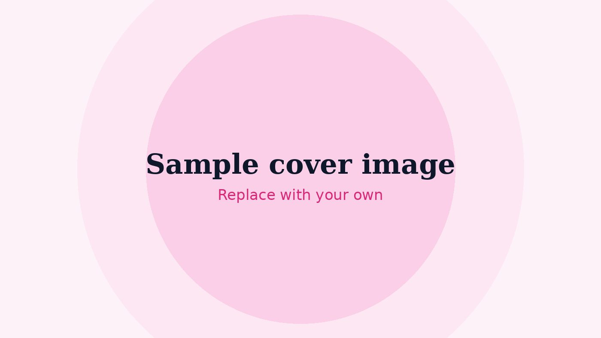

This is a placeholder post. It's here only to show how a blog entry looks on the site, and it should be deleted before the blog goes live.

The text you write in a post's Markdown file shows up here. Below are the kinds of formatting you can use.

## A section heading

Start a line with `##` to make a heading like the one above. Use **two asterisks** for bold text and *one asterisk* for italics.

- A bulleted list starts each line with a dash
- Like this
- And this

1. A numbered list starts each line with a number
2. Like this

> A line that starts with `>` becomes a quote.

[This is a link](https://peoplessocialmarketing.com/) and below is an image placed inside the post:

